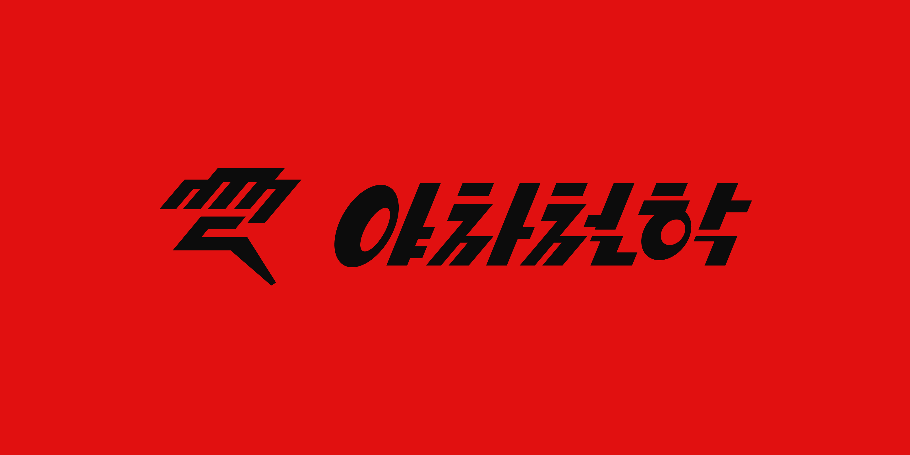

# 야차판 (YACHAPAN)

> 생각이 다른 사람과 철학으로 맞붙는 1:1 토론 배틀 플랫폼

[서비스 바로가기](https://yachapan.cloud) · [Frontend Repository](https://github.com/LIKELION14-DemoDay/yacha-frontend) · [협업 가이드](https://github.com/LIKELION14-DemoDay/yacha-frontend/blob/main/%20CONTRIBUTING.md)

## 📑 목차

- [프로젝트 소개](#프로젝트-소개)
- [주요 기능](#주요-기능)
- [기술 스택](#기술-스택)
- [아키텍처 및 디렉터리 구조](#아키텍처-및-디렉터리-구조)
- [PWA](#pwa)
- [Team](#team)

## 프로젝트 소개

### Brand Story

철학은 원래 조용히 책으로만 읽는 학문이 아니었습니다. 서로 질문하고 반박하며 자신의 논리를 다듬는 치열한 대화 속에서 발전해 왔습니다. 하지만 오늘날 철학은 여전히 어렵고 무거운 학문으로 느껴지곤 합니다.

반면 우리는 매일 댓글과 커뮤니티에서 의견을 나누고, 다른 사람의 주장에 반박하며 살아갑니다.

**그렇다면 우리가 이미 즐기고 있는 ‘키보드 배틀’을 철학으로 바꿀 수 없을까?**

야차판은 이 질문에서 출발했습니다. 같은 딜레마에 서로 다른 선택을 한 두 사람이 짧은 시간 동안 자신의 근거를 제시하고 상대의 주장을 반박합니다. AI는 토론의 논리와 진행 내용을 분석하여, 단순한 말싸움을 생각을 확장하는 경험으로 연결합니다.

### Overview

사용자는 철학적 질문에 대한 자신의 입장을 선택하고, 다른 의견을 가진 상대와 **1:1 토론 배틀**을 진행합니다. 주장을 펼치고 반론을 주고받은 뒤 토론 결과를 확인할 수 있습니다.

또한 **1분 철학**, **밸런스 게임**, **북마크**, **마이페이지** 등의 콘텐츠를 통해 철학을 단순히 읽는 데서 끝내지 않고, **선택하고 · 말하고 · 부딪히는 경험**으로 확장합니다.

### Mission

> **“철학을 가장 자극적이고 재미있는 사고의 놀이로”**

어렵게 느껴지는 철학적 질문을 누구나 참여할 수 있는 짧은 대결과 콘텐츠로 바꾸고, 자신의 의견을 표현하며 타인의 관점을 마주하는 경험을 일상 속으로 가져오는 것이 야차판의 목표입니다.

## 주요 기능

| 기능                     | 설명                                                                        |
| ------------------------ | --------------------------------------------------------------------------- |
| **1:1 철학 토론 배틀**   | 딜레마에 대한 입장을 선택하고 상대와 실시간으로 주장과 반론을 주고받습니다. |
| **실시간 토론 진행**     | 대기, 입장 선택, 토론 단계, 채팅, 결과 확인 등의 흐름을 제공합니다.         |
| **1분 철학**             | 짧은 철학 주제와 철학자들의 관점을 읽으며 생각을 확장합니다.                |
| **밸런스 게임**          | 질문에 대한 선택을 통해 자신의 가치관을 돌아봅니다.                         |
| **북마크 및 마이페이지** | 관심 있는 콘텐츠를 보관하고 개인 설정을 관리합니다.                         |
| **회원·소셜 로그인**     | 이메일 로그인과 카카오·구글 로그인 흐름을 지원합니다.                       |

## 기술 스택

| Category                   | Stack                                                                                                                                                                                                                            |
| :------------------------- | :------------------------------------------------------------------------------------------------------------------------------------------------------------------------------------------------------------------------------- |
| **Language**               |                                                                                                                 |
| **Framework**              |                                                                                                                         |
| **Styling**                |   |
| **Routing**                |                                                                                                            |
| **API / Networking**       |                                                                                                                                |
| **Realtime**               |                                            |
| **Animation**              |                                                                                                                                         |
| **PWA**                    |                     |
| **Build Tool**             |                                                                                                                               |
| **Infrastructure**         |                                                                                                                             |
| **Code Quality / Linting** |                                                                                                                             |
| **Package Manager**        |                                                                                                                                      |

## 아키텍처 및 디렉터리 구조

### 프론트엔드 구성

- **React Router**: 페이지 라우팅 및 인증이 필요한 화면 접근 제어
- **Axios 공통 클라이언트**: API 통신, 액세스 토큰 첨부, 토큰 재발급 처리
- **토큰 관리**: 액세스 토큰은 프론트엔드 메모리에서 관리하며, 리프레시 토큰은 백엔드가 발급한 HttpOnly 쿠키를 사용
- **STOMP WebSocket**: 실시간 토론 세션 이벤트, 채팅, 재연결 및 구독 관리
- **Vite 개발 프록시**: 로컬 개발 시 `/api` 및 `/ws` 요청을 백엔드로 전달

### 디렉터리 구조

```text
src/
├── apis/                        # 백엔드 통신 계층
│   ├── auth.ts                  # 회원가입·로그인·토큰·비밀번호 재설정
│   ├── client.ts                # Axios 인스턴스·인증 인터셉터
│   ├── socket.ts                # STOMP WebSocket 연결·구독·발행
│   ├── tokenStore.ts            # 액세스 토큰 상태 관리
│   ├── balanceGame.ts           # 밸런스 게임 API
│   ├── sessions.ts              # 토론 세션 API
│   └── ...                      # 사용자·주제·철학 콘텐츠 API
├── assets/                      # 이미지·SVG 등 정적 에셋
├── components/                  # 공통 UI 컴포넌트
├── hooks/                       # 재사용 가능한 커스텀 훅
├── pages/                       # 라우트별 화면 컴포넌트
│   ├── BalanceGamePage/         # 밸런스 게임
│   ├── GamePage/                # 실시간 토론·매칭·결과
│   ├── LoginPage/               # 로그인·회원가입·OAuth 콜백
│   ├── MyPage/                  # 마이페이지·북마크·설정
│   ├── OneminutePage/           # 1분 철학 목록·상세
│   ├── HomePage.tsx             # 홈 화면
│   └── OnboardingPage.tsx       # 온보딩
├── types/                       # 공통 TypeScript 타입
├── utils/                       # 인증·오류·카테고리 등 유틸리티
├── App.tsx                      # 라우팅 및 인증 가드
├── main.tsx                     # React 애플리케이션 진입점
└── index.css                    # 전역 스타일 및 디자인 토큰

public/                           # PWA 아이콘·정적 파일 등
index.html                        # HTML 진입점
vite.config.ts                    # Vite 프록시 및 PWA 설정
vercel.json                       # Vercel SPA 라우팅 설정
```

## PWA

### Progressive Web App (PWA)

야차판은 `vite-plugin-pwa` 기반 PWA 설정을 사용합니다.

| 항목             | 설정                 |
| ---------------- | -------------------- |
| 앱 이름          | 야차판               |
| 실행 모드        | `standalone`         |
| 서비스 워커 등록 | `autoUpdate`         |
| 앱 아이콘        | `public/applogo.png` |

## Team

|  |  |
| :----------------------------------------------------------------: | :--------------------------------------------------------------------: |
|          권오진 <br/> [@KOJ50](https://github.com/KOJ50)           |        김민준 <br/> [@mrainbeat](https://github.com/mrainbeat)         |
|                            **Frontend**                            |                              **Frontend**                              |

.
